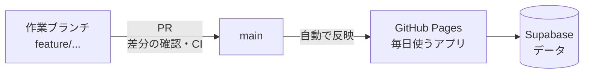

# maney-app

予定・お金・タスクを1つにまとめた、自分用の生活管理アプリ（PWA）。
iPhoneのホーム画面から毎日使っている。

**開発の現在地**: 基本のタスク管理、DB のテーブル分割、TypeScript への移行、イベント登録、Service Worker のビルド連動は完了（2026-11-03）。残作業は [ROADMAP](docs/ROADMAP.md) の未チェック項目と [GitHub の Issues](https://github.com/Keitaro0510/maney-app/issues)。

**公開URL**: https://keitaro0510.github.io/maney-app/

---

## 今できること

- **ホーム**: 口座残高の推定、今後の残高グラフ、今日使える金額、これからの入出金と予定
- **カレンダー**: 予定（時刻・期間・予算つき、完了チェック）、月表示と日の詳細、祝日
- **家計簿**: 収支の記録、カテゴリ、月送り、月・年のグラフ
- **シフト**: アルバイトのシフトと給与の見込み（深夜割増・休憩・交通費）
- **設定**: カード（締め日・引き落とし日）、予算。毎月のお金は家計簿のタブから管理
- **タスク**: 追加・編集・完了・削除、期限とメモ、ホームの期限一覧、カレンダーへの表示
- Googleログイン（Supabase）で、データをクラウドに保存

## これからやること: 予定・お金・タスクの連携

基本のタスク管理は実装済み。今後は次の連携を検討する（[ROADMAP](docs/ROADMAP.md) の Phase 6）。その前に、使って見つかったタスクの改善（Issue #137・#139）を検討している。着手順は ROADMAP を参照。

- 予定にひもづく準備のタスク（例: 旅行の予定 →「宿の予約」「交通の予約」）
- 毎月くり返すタスク（例: 家賃の振り込み）
- お金との連携（例: カードの引き落とし前に残高が足りなそうなら、「入金する」タスクを自動で出す）

このアプリならではの価値は、**予定・お金・タスクが同じ場所にあること**。単体のタスク管理アプリにはできない連携を作る。

---

## 方針: 動いているアプリを壊さずに改修する

今は画面の HTML（`index.html`）・見た目（`css/app.css`）・動き（`src/` の TypeScript）と、Supabase の12のテーブルでできている（データの構造は [docs/db/SCHEMA.md](docs/db/SCHEMA.md)。2026-10-29 に、全データを JSON 1行に入れていた形から切り替えた）。これまで次の順で進めてきた。1〜5 は実装済みで、6 が今後の機能開発にあたる。

1. **ブランチとPRで変更する流れを身につける**（main がそのまま本番なので、main で直接作業しない）
2. **安全網を張る**（データのエクスポート、計算ロジックのテスト、CI）
3. **タスク管理を足す**
4. **ファイルを機能ごとに分割し、TypeScriptに移す**
5. **データを正規化したテーブルに移す**（2026-10-29 に済み、#11）
6. **お金・予定・タスクを連携させる**



## 学ぶ技術

| 技術 | このリポジトリでの使いどころ | 到達目標 |
|---|---|---|
| Git のブランチ・PR・コンフリクトの解決・タグ・revert | すべての改修 | 本番を壊さずに変更を届けられる |
| ESモジュール / Vite | 1ファイルを機能ごとのファイルに分ける（2026-11-01 に Vite を入れた。D4） | 既存のコードを安全に分割できる |
| TypeScript（段階的に導入） | 計算ロジックから型を付ける | 既存のJSを少しずつTypeScriptに移せる |
| Node.js のテストランナー（`node --test`） | 残高・締め日・給与の計算のテスト | テストで守りながら改修できる |
| Supabase（PostgreSQL・RLS・マイグレーション） | JSONB からテーブルへの移行（済み）、タスクのテーブル | 使いながらデータの構造を移せる |
| GitHub Actions | PRごとのテスト、Pagesへのデプロイ、キャッシュ名の自動更新 | 手作業による更新ミスをなくす |
| Web Push（任意） | 期限の通知 | iOSのホーム画面アプリに通知を送れる |

## 手元で動かす

最初に1回だけ、部品を入れる（Node.js 24 と npm が要る）:

```bash
npm install
```

| やること | コマンド |
|---|---|
| 手元で開く（直すとすぐ反映） | `npm run dev` → http://127.0.0.1:8765/ |
| テスト | `npm test` |
| 結合テスト（ローカルの Supabase を立ててから） | `npm run test:integration`（[db/LOCAL.md](docs/db/LOCAL.md)） |
| 画面を比べる（ローカルの Supabase を立ててから） | `npm run test:screens`（[db/LOCAL.md](docs/db/LOCAL.md) の「画面を比べる」） |
| 公開と同じ形にビルドする | `MANEY_TARGET=prod bash scripts/build-pages.sh`（`_site` に出る。接続先の指定が要る。D19） |
| ローカルの Supabase につないで開く | `npm run preview:local`・`npm run dev:local`（[db/LOCAL.md](docs/db/LOCAL.md)） |

- Vite を使っている（[D4](docs/DECISIONS.md)）。計算・データ・画面・起動を `src/` の TypeScript（ES モジュール）に移した（D20 の 0〜10。2026-11-03）。`js/` に実行ファイルは残っていない。HTML のイベント属性と、そのための `window` への関数公開も D18 の手順5で削除した
- 型の検査は `npm run typecheck`（CI でも動く）。`main` を取り込んで `package.json` が変わっていたら、もう一度 `npm install` する
- Windows の PC で `npm run typecheck` を初めて動かすときは、TypeScript 7 の実行ファイル（`tsc.exe`）がアプリケーション制御で止まらないかを確かめる（`supabase.exe` が止まった PC もある。止まっても `npm test` と CI の型の検査は動く）
- **ほかの PC で続きを始めるとき**: `git fetch origin main` と `gh pr list --state open` で最新の状態を確認し、[ROADMAP](docs/ROADMAP.md) の未チェック項目と Issues を読む。最新の `main` から作業ブランチを切り、Node.js 24 で `npm install` する。画面や保存の変更では、ローカルの Supabase を起動して `npm run test:screens`・`npm run test:integration` も確かめる（[docs/db/LOCAL.md](docs/db/LOCAL.md)）。
- 公開は自動: main に入ると GitHub Actions がビルドして GitHub Pages に出す（[D15](docs/DECISIONS.md)、`.github/workflows/deploy.yml`）
- 祝日を読む Google のキーは 127.0.0.1:8765 だけを許しているので、手元ではこの場所で開く

## 資料

- ブランチとPRの流れ・練習メニュー: [docs/GIT_WORKFLOW.md](docs/GIT_WORKFLOW.md)
- やること: [docs/ROADMAP.md](docs/ROADMAP.md)
- 自分で決める設計判断: [docs/DECISIONS.md](docs/DECISIONS.md)
- 画面の構成と遷移（どこを押すとどの画面に行くか）: [docs/SCREENS.md](docs/SCREENS.md)
- 外部設計・内部設計・UI の監査（Claude・Codex、2026-10-29）: [docs/design-review/](docs/design-review/README.md)
- データの構造（ER 図・保存の流れ）: [docs/db/SCHEMA.md](docs/db/SCHEMA.md)
- データを戻す手順: [docs/db/RESTORE.md](docs/db/RESTORE.md)
- テーブル分割の設計と記録（#11）: [docs/db/TABLE_SPLIT.md](docs/db/TABLE_SPLIT.md)
- ローカルで DB を動かす・テストする: [docs/db/LOCAL.md](docs/db/LOCAL.md)
- 今は使っていないもの（月次アドバイス・LINE通知の GAS、DB の診断と整備の方針）: [archive/](archive/)
- iOS PWA と Supabase のトラブル対応メモ: [docs/troubleshooting-ios-pwa.md](docs/troubleshooting-ios-pwa.md)
- PWA・Supabase・Googleログインの構築ガイド: [pwa-supabase-google-full-guide.md](pwa-supabase-google-full-guide.md)
