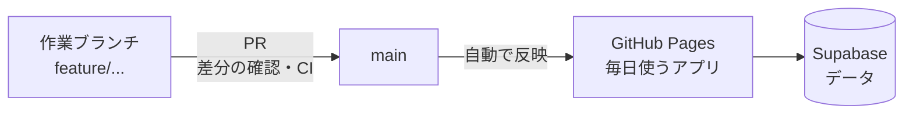

# maney-app

予定・お金・（これから）タスクを1つにまとめた、自分用の生活管理アプリ（PWA）。
iPhoneのホーム画面から毎日使っている。

**公開URL**: https://keitaro0510.github.io/maney-app/

---

## 今できること

- **ホーム**: 口座残高の推定、今後の残高グラフ、今日使える金額、これからの入出金と予定
- **カレンダー**: 予定（時刻・期間・予算つき、完了チェック）、日・週・月の表示、祝日
- **家計簿**: 収支の記録、カテゴリ、月送り、月・年のグラフ
- **シフト**: アルバイトのシフトと給与の見込み（深夜割増・休憩・交通費）
- **設定**: カード（締め日・引き落とし日）、固定費・固定収入、予算
- Googleログイン（Supabase）で、データをクラウドに保存

## これからやること: タスク管理を足す

- 「やること」を期限つきで登録し、カレンダーとホームに表示する
- 予定にひもづく準備のタスク（例: 旅行の予定 →「宿の予約」「交通の予約」）
- 毎月くり返すタスク（例: 家賃の振り込み）
- お金との連携（例: カードの引き落とし前に残高が足りなそうなら、「入金する」タスクを自動で出す）

このアプリならではの価値は、**予定・お金・タスクが同じ場所にあること**。単体のタスク管理アプリにはできない連携を作る。

---

## 方針: 動いているアプリを壊さずに改修する

今は `index.html` 1ファイル（約2,100行）で、全データをSupabaseのJSONB 1行に保存している。毎日使いながら、次の順で少しずつ直す。

1. **ブランチとPRで変更する流れを身につける**（main がそのまま本番なので、main で直接作業しない）
2. **安全網を張る**（データのエクスポート、計算ロジックのテスト、CI）
3. **タスク管理を足す**
4. **ファイルを機能ごとに分割し、TypeScriptに移す**
5. **データを正規化したテーブルに移す**
6. **お金・予定・タスクを連携させる**

## 学ぶ技術

| 技術 | このリポジトリでの使いどころ | 到達目標 |
|---|---|---|
| Git のブランチ・PR・コンフリクトの解決・タグ・revert | すべての改修 | 本番を壊さずに変更を届けられる |
| ESモジュール / Vite | 1ファイルを機能ごとのファイルに分ける | 既存のコードを安全に分割できる |
| TypeScript（段階的に導入） | 計算ロジックから型を付ける | 既存のJSを少しずつTypeScriptに移せる |
| Vitest | 残高・締め日・給与の計算のテスト | テストで守りながら改修できる |
| Supabase（PostgreSQL・RLS・マイグレーション） | タスクのテーブル、JSONBからの移行 | 使いながらデータの構造を移せる |
| GitHub Actions | PRごとのテスト、Pagesへのデプロイ、キャッシュ名の自動更新 | 手作業による更新ミスをなくす |
| Web Push（任意） | 期限の通知 | iOSのホーム画面アプリに通知を送れる |

## 資料

- ブランチとPRの流れ・練習メニュー: [docs/GIT_WORKFLOW.md](docs/GIT_WORKFLOW.md)
- やること: [docs/ROADMAP.md](docs/ROADMAP.md)
- 自分で決める設計判断: [docs/DECISIONS.md](docs/DECISIONS.md)
- DB整備の方針（作業は Issue #8〜#11）: [DB整備方針.md](DB整備方針.md)
- 月次アドバイス・LINE通知（GAS）: [sync/](sync/)
- iOS PWA と Supabase のトラブル対応メモ: [docs/troubleshooting-ios-pwa.md](docs/troubleshooting-ios-pwa.md)
- PWA・Supabase・Googleログインの構築ガイド: [pwa-supabase-google-full-guide.md](pwa-supabase-google-full-guide.md)
