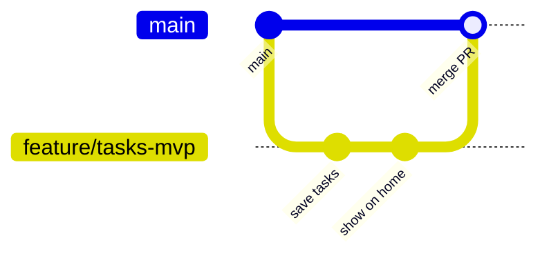

# ブランチとPRの流れ

## なぜブランチを使うのか

このリポジトリは **main ブランチがそのまま GitHub Pages の本番**になっている。main に push した瞬間に、毎日使っているアプリが変わる。
作業の途中の壊れた状態を本番に出さないために、作業は必ずブランチで行い、確認してから main に取り込む。

## 用語

| 用語 | 意味 |
|---|---|
| ブランチ | 作業用の分かれ道。main を変えずに変更を積み重ねられる |
| コミット | 変更の記録の単位 |
| push | 手元のコミットを GitHub に送ること |
| プルリクエスト（PR） | 「このブランチを main に取り込みたい」という依頼。差分の確認・CI・レビューをする場所 |
| マージ | ブランチの変更を main に取り込むこと |
| コンフリクト | 2つのブランチが同じ箇所を別々に変えたときに起きる衝突 |

## 基本の流れ（GitHub Flow）



```bash
# 1. main を最新にする
git switch main
git pull

# 2. 作業用のブランチを作って移る
git switch -c feature/tasks-mvp

# 3. 変更して、小さくコミットする
git add -p          # 変更を1か所ずつ確認しながら選ぶ（VS Codeのソース管理画面でもできる）
git commit -m "Add task list to home"

# 4. GitHub に送って PR を作る
git push -u origin feature/tasks-mvp
gh pr create --fill # GitHub の画面から作ってもよい

# 5. PR の差分を自分で見直し、（CI を入れたら）テストが通るのを確かめてからマージする
gh pr merge --squash --delete-branch

# 6. 手元を片付ける
git switch main
git pull
git branch -d feature/tasks-mvp
```

**index.html を変えたら sw.js の `CACHE_NAME` も上げる**（Phase 2 で自動化するまでの約束。上げ忘れると、スマホに古い画面が残る）。

## ブランチ名の付け方

| 接頭辞 | 用途 | 例 |
|---|---|---|
| `feature/` | 新しい機能 | `feature/tasks-mvp` |
| `fix/` | 不具合の修正 | `fix/balance-chart` |
| `refactor/` | 動きを変えずに中身を整理 | `refactor/split-calendar` |
| `docs/` | ドキュメントだけの変更 | `docs/add-plan` |
| `chore/` | 設定や依存関係 | `chore/add-vitest` |

## 練習メニュー（上から順に）

1. [ ] **最初のPR（`docs/add-plan`: この計画の追加）を、自分でレビューしてマージする**
   - GitHub の PR を開き、「Files changed」で差分を見る。気になる行にコメントを書いてみる
   - 「Squash and merge」でマージし、ブランチを削除する
   - 手元で `git switch main`、`git pull`、`git branch -d docs/add-plan`
2. [ ] 小さな変更を、自分で ブランチ → PR → マージ までやってみる（例: 動かなくなった機能の画面を片付ける）
3. [ ] わざとコンフリクトを起こして解決する
   - `practice/a` と `practice/b` の2つのブランチで、README の同じ行を別々に書き換える
   - a を先にマージすると、b の PR でコンフリクトが出る → 手で直してマージする（終わったら両方消す）
4. [ ] main を保護する（GitHub の Settings → Rules → Rulesets で、「main への直接の push を禁止」「マージには PR を必須」にする）
5. [ ] CI を入れて、テストが通らないとマージできないようにする（Phase 2）
6. [ ] 動いているバージョンにタグを付ける（`git tag v1.0.0`、`git push origin v1.0.0`）。GitHub の Releases に変更点を書く
7. [ ] マージした変更で不具合が出たら、`git revert` で打ち消す PR を作って戻す（履歴を消さずに戻す方法）
8. [ ] 長く続く作業（Phase 4 のファイル分割）の途中で main に入った変更を取り込む。`git merge main` と `git rebase main` の違いを試す
9. [ ] 本番の前に確認できる環境を作る（[D8](DECISIONS.md)）

## つまずいたとき

- **main のまま作業してしまった**: コミット前なら `git switch -c 新しいブランチ名` で、変更ごと新しいブランチに移れる
- **コミットのメッセージを間違えた（push 前）**: `git commit --amend`
- **履歴を書き換える操作**（amend、rebase、force push）は、push した後なら「自分しか使っていないブランチ」でだけ行う。main では絶対にしない
- **消してしまった・戻したい**: `git reflog` で過去の状態を探せる
