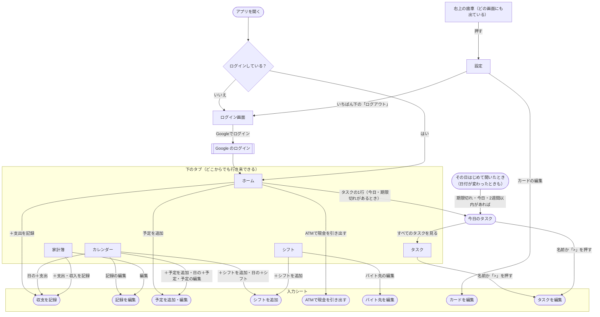
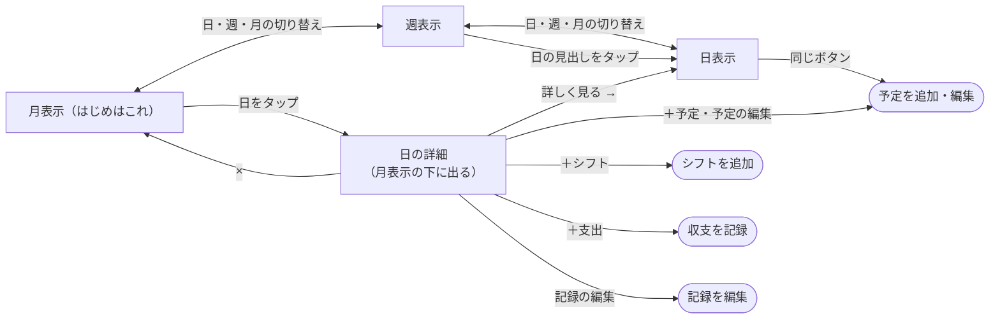

# 画面の構成と遷移（2026-10-29 時点。2026-10-31 に設定の開き方を直し、タスクを足した）

今のアプリ（`index.html`）で、どこを押すとどの画面に行くかをまとめた「今の地図」。画面を作り直すとき（タスクを足す・タブを組み替える）の出発点にする。

- 図は今の動きを書いたもので、こうあるべきという案ではない。問題点は [design-review/audit-claude.md](design-review/audit-claude.md) と [design-review/audit-codex.md](design-review/audit-codex.md)
- 行番号は `index.html` のもの。画面を変えたら、この図も直す

## 用語

| 用語 | ここでの意味 |
|---|---|
| タブ | 画面の下に並ぶ5つ（ホーム・カレンダー・家計簿・シフト・タスク）。どの画面からでも行き来できる。設定は右上の歯車から開く（D10） |
| 入力シート | 下からせり上がる入力の画面（モーダル）。「キャンセル」か「保存」で閉じ、元の画面に戻る。外側のタップやスワイプでは閉じない |
| その場の操作 | 画面を移らずにできること（削除、実績の入力、月送りなど） |

## 全体の流れ

右上の歯車（`#settings-btn`）は、ログインしたあとはどの画面にも出ている。設定を開いている間は色が付く。ログイン中のアカウントとログアウトは、設定のいちばん下にある（D10）。送れていない変更があるときは、ログアウトの前に確認の通知が出る（`logout`）。

## カレンダーの中の動き

カレンダーは「日・週・月」の3つの表示を切り替える。月表示で日をタップすると、カレンダーの下に「日の詳細」が出る（別の画面には移らない）。

- タスク（D10）: 月表示のセルは「タスク2」の札（期限が過ぎた日に残っていれば赤、全部済んでいれば薄く「タスク済」）。日の詳細は名前だけ（見るだけ。完了はタスクのタブで）。日表示・週表示は「タスク 2件」の1行だけ
- 週表示には編集・削除のボタンがない（予定の「済み」のチェック（予算に含めない。D2）だけある）。日表示と日の詳細にはある（`index.html:1631-1694` の `buildDay`）
- 「← →」は、月表示なら1か月、週表示なら7日、日表示なら1日動く（`index.html:1709-1720`）

## 入力シートの一覧

| 入力シート | 開く場所 | 保存するテーブル | 行 |
|---|---|---|---|
| 収支を記録 | ホーム・カレンダー（日の詳細・日表示）・家計簿 | `ledger_entries` | 794、1944 |
| 記録を編集 | カレンダー（日の詳細・日表示）・家計簿 | `ledger_entries` | 791、1971 |
| 予定を追加・編集 | ホーム（追加だけ）・カレンダー | `plans` | 775-789、2226、2248 |
| シフトを追加（日付を複数選べる） | カレンダー・シフト | `shifts` | 792、1824 |
| ATMで現金を引き出す | ホーム | `withdrawals`（日付は今日に決まる） | 774、1812 |
| バイト先を編集 | シフト（バイト先一覧） | `jobs`（名前を変えると、シフトと給与の実績の名前も書き換える） | 793、1933 |
| カードを編集 | 設定（クレジットカード） | `cards` | 790、1788 |
| タスクを編集（`<dialog>`） | タスク・今日のタスク | `tasks`（`saveRows`。互換の `st` を通さない） | `js/tasks-ui.js` の `openTaskSheet` |
| 今日のタスク（`<dialog>`。その日はじめて開いたとき） | 起動したあと・日付が変わったとき・ホームのタスクの1行 | `tasks`（完了のチェック） | `js/tasks-ui.js` の `maybeShowStartupTasks` |

## その場の操作（画面を移らない）

| タブ | できること |
|---|---|
| ホーム | 見るだけ（残高・今日使える・グラフ・見通し・カードの予測・予算・今後の予定）。項目をタップしても何も起きない |
| カレンダー | 予定の「済み」のチェック（予算に含めない。D2）、予定・記録の削除 |
| 家計簿 | 記録一覧とグラフの切り替え、月送り（グラフは月・年）、日ごとのまとまりの開閉、記録の削除 |
| シフト | 給与の実績の入力（`salary_actuals`）、シフト一覧の月送り、シフトの削除、バイト先の追加（`jobs`）・削除 |
| タスク | 上の欄で追加（期限は なし・今日・明日・日付）、完了のチェック（横線で残し、7日たったら「完了したタスク」にたたむ）。削除は編集の画面から、「元に戻す」付き |
| 設定 | 残高・基準日・予算・給料サイクル・扶養の入力（いちばん下の「設定を保存」で `settings` に保存）、固定費・固定収入・カテゴリ・カードの追加と削除（押した瞬間に保存）、カードの引き落とし実績の入力（`card_bill_actuals`）、ATM の履歴の削除 |

削除は、どれも確認なしで押した瞬間に消える。

## どの画面にも出るもの

| 表示 | 出るとき | 行 |
|---|---|---|
| 同期の通知（画面の下） | 保存できない・別の端末とぶつかった・読み込めなかった。「サーバーの内容にする」「この端末の内容で上書き」などを選ぶ | 743-748、974-1096 |
| 送信待ちの件数（左上） | まだ送れていない変更があるとき | 509、964-969 |

## タブと主な関数

| タブ | 描く関数 | 主な計算 |
|---|---|---|
| ホーム | `renderHome`（1447）、`renderHomeStatus`（2308）、`renderForecast`（1445）、`renderBalanceChart`（1418） | `estimateAcct`（1375）、`buildBalanceSeries`（1380）、`upcomingIncome`・`upcomingFixed`（1423-1424）、`cycle`（1347） |
| カレンダー | `renderCal`（1495）、`renderCalMonth`（1506）、`renderCalWeek`（1593）、`renderCalDay`（1572）、`dayClick`（1699） | `buildDay`（1631）、`fetchHolidays`（1456） |
| 家計簿 | `renderLedger`（2040）、`renderLedgerMetrics`（2039）、`renderCharts`（2147） | `monthLedger`（1295） |
| シフト | `renderShiftSection`（1837）、`renderSalaryTable`（1838）、`renderFuyou`（1924）、`renderShiftList`（1836）、`renderJobList`（1930） | `calcShiftInc`（1314）、`yearConfirmedIncome`・`yearEstimatedIncome`（1894-1923） |
| タスク | `renderTaskTab`（`js/tasks-ui.js`） | `js/tasks.js` の `groupForTab`・`startupGroups`・`dueLabel` |
| 設定 | `initSettingTab`（2166）、`renderCardList`（1786）、`renderFcList`（2157）、`renderFiList`（2164）、`renderCatTags`（2162） | `cardCycleForBillMonth`（1333） |

タブの切り替えは `sw()`（`index.html:1274`）。切り替えるたびに、そのタブを全部描き直す。
