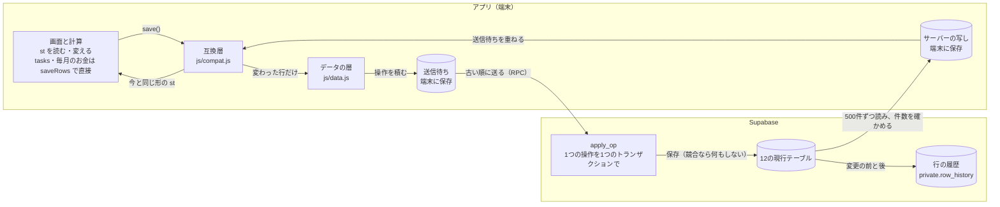

# データの構造

Supabase（PostgreSQL）のリレーショナルデータベース。2026-10-29 に、全データを1行の JSON（`user_data`）に入れていた形から、12のテーブルに分けた形に切り替えた（テーブル分割 #11。経緯と設計は [TABLE_SPLIT.md](TABLE_SPLIT.md)）。2026-10-31 にタスクを足し、同日に固定収入を `fixed_costs` の「収入」へまとめたため、アプリが読む表は12のまま（D1・D3・D14）。

古い `fixed_incomes` 表は、90日間の行の履歴と移行前のスナップショットを戻せるよう残しているが、行は移行時に空にし、アプリは読み書きしない。過去の固定収入を戻す操作は、自動的に `fixed_costs` の収入へ変換する。

- 定義はすべて [`supabase/migrations/`](../../supabase/migrations/) にある。テストは [`supabase/tests/`](../../supabase/tests/)
- どのテーブルにも `id`（uuid）・`user_id`（`auth.users` を指す）・`created_at`・`updated_at`（サーバーの時刻）がある。一覧のテーブルには並び順の `position` もある（下の図では省いた）
- 本人の行だけを読み書きできる（RLS）。アカウントを消すと、そのユーザーの行も一緒に消える

## テーブルどうしの関係（ER 図）

カード・バイト先・カテゴリが参照される側で、記録はそれを ID で指す（外部キー）。`o|` の側は「空でもよい」（カード払いのときだけ指す）。

```mermaid
erDiagram
  cards |o--o{ ledger_entries : "card_id（カード払いのとき）"
  categories ||--o{ ledger_entries : "category_id"
  cards |o--o{ plans : "card_id（カード払いのとき）"
  cards |o--o{ fixed_costs : "card_id（カード払いのとき）"
  cards ||--o{ card_bill_actuals : "card_id"
  jobs ||--o{ shifts : "job_id"
  jobs ||--o{ salary_actuals : "job_id"

  cards {
    uuid id PK
    text name
    smallint close_day "締め日（28以上は月末）"
    smallint bill_day "引き落とし日"
    timestamptz deleted_at "削除済み"
  }
  jobs {
    uuid id PK
    text name
    text color
    integer wage "時給"
    time night_start "深夜の開始"
    integer night_rate "深夜の割増（%）"
    integer transport "片道の交通費"
    smallint close_day "空なら設定の締め日"
    smallint pay_day "空なら設定の給料日"
    timestamptz deleted_at "削除済み"
  }
  categories {
    uuid id PK
    text kind "expense / income"
    text name
    timestamptz deleted_at "削除済み"
  }
  ledger_entries {
    uuid id PK
    date date
    text kind "expense / income"
    integer amount "0以上"
    text name
    text memo
    uuid category_id FK
    text payment_method "cash / card / bank"
    uuid card_id FK "カード払いのときだけ"
  }
  shifts {
    uuid id PK
    date date
    uuid job_id FK
    time start_time
    time end_time
    integer wage "その日の時給（計算には使わない）"
    integer rest_minutes "休憩（分）"
  }
  plans {
    uuid id PK
    text title
    date start_date
    date end_date
    time start_time "空なら終日"
    time end_time
    integer budget
    boolean done
    text memo
    text color
    uuid card_id FK "カード払いのときだけ"
    bigint legacy_id "切り替える前の JSON の id"
  }
  fixed_costs {
    uuid id PK
    text name
    integer amount
    smallint day
    text kind "expense / income"
    text payment_method "bank / cash / card（入金は空）"
    uuid card_id FK "カード払いのときだけ"
    date start_month "いつから（月の1日。空なら前から）"
    date end_month "いつまで（月の1日。空なら続く）"
    bigint legacy_id "切り替える前の JSON の id"
  }
  salary_actuals {
    uuid id PK
    uuid job_id FK
    date pay_month "支払月の1日"
    date paid_on "入金日"
    integer actual_amount
    integer estimated_amount
  }
  card_bill_actuals {
    uuid id PK
    uuid card_id FK
    date bill_month "引き落としの月の1日"
    integer actual_amount
    integer estimated_amount
  }
  settings {
    uuid id PK
    integer acct_base "口座残高"
    date base_date "残高の基準日"
    integer budget
    integer other_income
    smallint shift_close_day
    smallint shift_pay_day
    text fuyou_limit "1030000 / 1300000 / both"
  }
  withdrawals {
    uuid id PK
    date date
    integer amount
  }
  tasks {
    uuid id PK
    text title
    date due_date "期限（空なら期限なし）"
    timestamptz completed_at "終えた日時（空なら未完了）"
    text memo
  }
```

`settings`（1人1行）・`withdrawals`（ATM の引き出し）・`tasks`（タスク）は、ほかのテーブルとつながらない。タスクと予定のひもづけ（`plan_id`）は Phase 6 で足す（D2）。

## DB が見張っていること

| 見張っていること | しくみ |
|---|---|
| 本人の行だけを読み書きできる。ログインしていない人は、どのテーブルにも触れない | RLS（`(select auth.uid()) = user_id`）と権限 |
| 他人のカード・カテゴリ・バイト先を指す記録は入らない | 外部キーを `(user_id, card_id) → cards (user_id, id)` の組で張る |
| 支出の記録に収入のカテゴリを付けられない | `(user_id, category_id, kind) → categories (user_id, id, kind)` |
| カード払いのときだけ `card_id` がある。支出は現金・カード・口座、収入は現金か口座（カード払いは支出だけ。2026-10-31 に支出の口座を足した。D11） | check 制約 |
| 固定費の「いつから」「いつまで」は月の1日で、いつまでは、いつから より前にできない（D14） | check 制約 |
| 金額は0以上、日は1〜31、扶養の上限・色・種類は決まった値だけ | check 制約 |
| 削除済みでないカード・バイト先・カテゴリの名前は重ならない。同じバイト先・同じ支払月の給与の実績は1件だけ | 一意制約（`deleted_at is null` の部分インデックス） |
| `created_at`・`updated_at` はサーバーの時刻。`id` と `user_id` はあとから変えられない | トリガー（`private.set_row_timestamps`） |

カード・バイト先・カテゴリは消さずに `deleted_at` を入れる。選択肢からは消えるが、過去の記録は正しい名前のまま表示し、引き落としなどの計算にも使い続ける。

## 保存と読み込み

アプリ（`index.html`）の画面と計算のコードは、切り替える前と同じ形のデータ（`st`）を読む。テーブルと `st` のあいだは、互換層（[`js/compat.js`](../../js/compat.js)）が変換する。互換層は移行のためだけのもので、画面を作り直すとき（ROADMAP の Phase 4）に消す（[DECISIONS.md の D9](../DECISIONS.md)）。

新しい機能のテーブル（`tasks` と、D14 の `fixed_costs`）は、互換層を通さない。画面は `currentRows()` の行を直接読み、`saveRows([...])` で直接保存する。今の画面の `save()` は、互換の `st` が持つテーブル（`MoneyData.COMPAT_TABLES`）だけを比べるので、直接保存する行を消したと見なすことはない。

- 1回のユーザーの操作（記録の追加、シフトの一括登録など）を1つの操作にする。`apply_op` は全部保存するか、何も保存しない
- 読み込んだときの `updated_at` と今の値が違えば、別の端末が先に変えたので保存しない。画面で「サーバーの内容にする」か「この端末の内容で上書き」を選ぶ
- 同じ操作が再送されても二重に保存しない（`applied_ops` に結果を残す）
- 通信できない間の操作は送信待ちに残り、通信が戻ったら送る

## 仕組みのためのテーブル

画面には出ない。`private` スキーマのものは、アプリからは読めない（SQL Editor か Supabase MCP で使う）。

| テーブル | 中身 | 使いみち |
|---|---|---|
| `public.sync_state` | 移行の番号と、切り替えた日時 | 移し直す前の古い操作を受け付けない |
| `public.applied_ops` | 保存できた操作の結果（90日） | 再送されても二重に保存しない |
| `private.row_history` | 行の変更の前と後（90日） | 1行だけ戻す・1つの操作を取り消す |
| `private.snapshots` | 全テーブルの写し（毎日・切り替えのとき） | ある時点に全体を戻す |
| `public.user_data` | 切り替える前の JSON（1行）。書き込みは止めている | 旧版のアプリに戻すとき用。片付けの2回目で消す |
| `private.archive_user_data` | 切り替える前の JSON の複製と履歴 | 経緯の記録 |

90日より古い履歴・操作の記録・毎日の写しは、pg_cron が毎日消す。戻し方は [RESTORE.md](RESTORE.md)。
